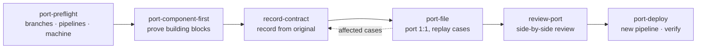

<p align="center">
  
</p>

<h1 align="center">service-port</h1>

<p align="center">
  <strong>Port a service 1:1 to another runtime — and prove it behaves the same — with Claude Code.</strong>
</p>

<p align="center">
  <a href="LICENSE"></a>
  
  
  
</p>

<p align="center">
  <a href="#quick-start">Quick start</a> ·
  <a href="#how-it-works">How it works</a> ·
  <a href="#skills">Skills</a> ·
  <a href="#guard-hooks">Guard hooks</a> ·
  <a href="#scripts">Scripts</a> ·
  <a href="TRAPS.md">Traps</a>
</p>

---

Rewriting a production service in another runtime (Node.js → .NET, Python → Go, …) is rarely hard because of the code. It is hard because of everything around it: code that only exists on a live branch, a library that *almost* matches, an event loop that runs things in a different order, a test suite too slow to run often, and a pipeline that deploys the moment a PR opens.

**service-port** gives Claude Code the workflow, guard rails and tooling to do this safely: record the original service's behaviour, port file by file against those recordings, and deploy without surprises.

## Highlights

- 🔎 **Find gaps on day one** — compare every live environment branch and pipeline with the port base before writing code.
- 🧩 **Prove building blocks first** — encoders, template engines, compression and event-loop ordering checked against recorded outputs before any route uses them.
- 📼 **Contract-driven porting** — every file is gated by cases recorded from the original service, including database, cache, storage, queue and log side effects.
- 🛡️ **No accidental deploys** — pushes and PRs to deploy branches are blocked until the user confirms.
- 🔐 **Secrets stay secret** — tokens, keys and URL credentials are masked in command output; JSON config through a shell is refused.
- ⚡ **Faster feedback** — run only affected cases, one isolated stack per worker, automatic flake triage.

## Quick start

In a Claude Code terminal session:

```text
/plugin install service-port --marketplace bulubuloa/claude-service-port
```

Answer `y` to add the marketplace, then choose a scope. The hooks are active right away; the skills load when a task needs them.

Then ask Claude, for example:

```text
Run port-preflight against origin/main for the dev, staging and production branches.
```

```text
Port src/routes/user/registry.ts with port-file and record its contract cases first.
```

## How it works



1. **Preflight** finds what the port base is missing and how each environment really deploys.
2. **Components first** removes the "equivalent library" surprises.
3. **Record → port → replay**: the original is always the source of truth; recorded expectations are never edited by hand.
4. **Deploy** from a new pipeline built from the live one, with the old pipeline retired, not overwritten.

## Skills

| Skill | When to use it |
| --- | --- |
| [`port-preflight`](skills/port-preflight/SKILL.md) | Before porting or deploying: environment-only code, live pipelines, local machine checks |
| [`port-component-first`](skills/port-component-first/SKILL.md) | Before routes: verify runtime-compatible building blocks against recorded outputs |
| [`record-contract`](skills/record-contract/SKILL.md) | Write and record contract cases from the original service, side effects included |
| [`port-file`](skills/port-file/SKILL.md) | Port one file or route group 1:1, gated by its cases |
| [`review-port`](skills/review-port/SKILL.md) | Review a port change side by side with the original |
| [`port-deploy`](skills/port-deploy/SKILL.md) | First deploy of the ported build: new pipeline, retire the old one, verify the rollout |

## Guard hooks

Every `Bash` call Claude makes passes through these checks:

| Situation | What happens |
| --- | --- |
| `git push` / `gh pr create` to a deploy branch | Refused until the user confirms; Claude then re-runs it with `SERVICE_PORT_CONFIRMED=1` |
| `CFG_X='{"json":…}'` passed through a shell | Refused — put overrides in a compose or env file instead |
| Service started directly on the host (`dotnet run`, `npm start`, …) | Allowed, with a warning toast |
| Tokens, private keys or `user:pass@` URLs in output | Masked before Claude reads them |

Example:

```text
> git push origin HEAD:publish-staging
✗ service-port: "publish-staging" is a deploy branch, so this push/PR deploys.
  Ask the user to confirm this exact action; after a clear yes, re-run with
  SERVICE_PORT_CONFIRMED=1 in front of the command.
```

### Configuration

Set in `/plugin` → **service-port** → configure:

| Option | Default | Meaning |
| --- | --- | --- |
| `deployBranchPattern` | `^(publish-\|deploy-\|release/)` | Branches whose push or PR deploys |
| `configEnvPrefix` | `CFG_` | Prefix of env vars that carry JSON config overrides |

## Scripts

Run from your repository root. Paths and commands are configurable through environment variables (see each script's header).

| Script | Purpose | Example |
| --- | --- | --- |
| [`affected-cases.sh`](scripts/affected-cases.sh) | List contract case files touched by the current change | `scripts/affected-cases.sh origin/main` |
| [`worker-stack.sh`](scripts/worker-stack.sh) | Private copy of the compose stack per worker, ports offset by worker number | `scripts/worker-stack.sh up 2` |
| [`flake-triage.sh`](scripts/flake-triage.sh) | Re-run failures alone; split real failures from timing flakes | `scripts/flake-triage.sh failed.txt 3` |

Optional `contract/case-map.txt` maps source paths to cases:

```text
# <source path glob>          <case file glob>
src/routes/user/*             http/user/*.json
src/synchronizer/*            http/synchronization/*.json
```

## Traps

[`TRAPS.md`](TRAPS.md) lists about 30 problems met while porting and deploying a real production service — emulated test images, event-loop ordering, libraries that differ in subtle ways, stale pipeline copies, dependency bots redeploying the old build — each with its symptom and fix. Read it before you start.

## Requirements

- [Claude Code](https://docs.anthropic.com/en/docs/claude-code) with plugin support
- `git`, `bash`; `gh` for PR-based deploys; Docker Compose for the contract stack
- A contract suite: requests recorded against the original service on a sealed stack and replayed against the new one (the skills explain how to build one)

## Development

```bash
git clone https://github.com/bulubuloa/claude-service-port
claude --plugin-dir ./claude-service-port    # load from disk
claude plugin validate ./claude-service-port # manifest + hooks
claude plugin test ./claude-service-port     # hook tests
```

## Contributing

Issues and pull requests are welcome — especially new traps, skills for other runtime pairs, and script improvements. Please run `claude plugin validate` and `claude plugin test` before opening a PR.

## License

[MIT](LICENSE)
